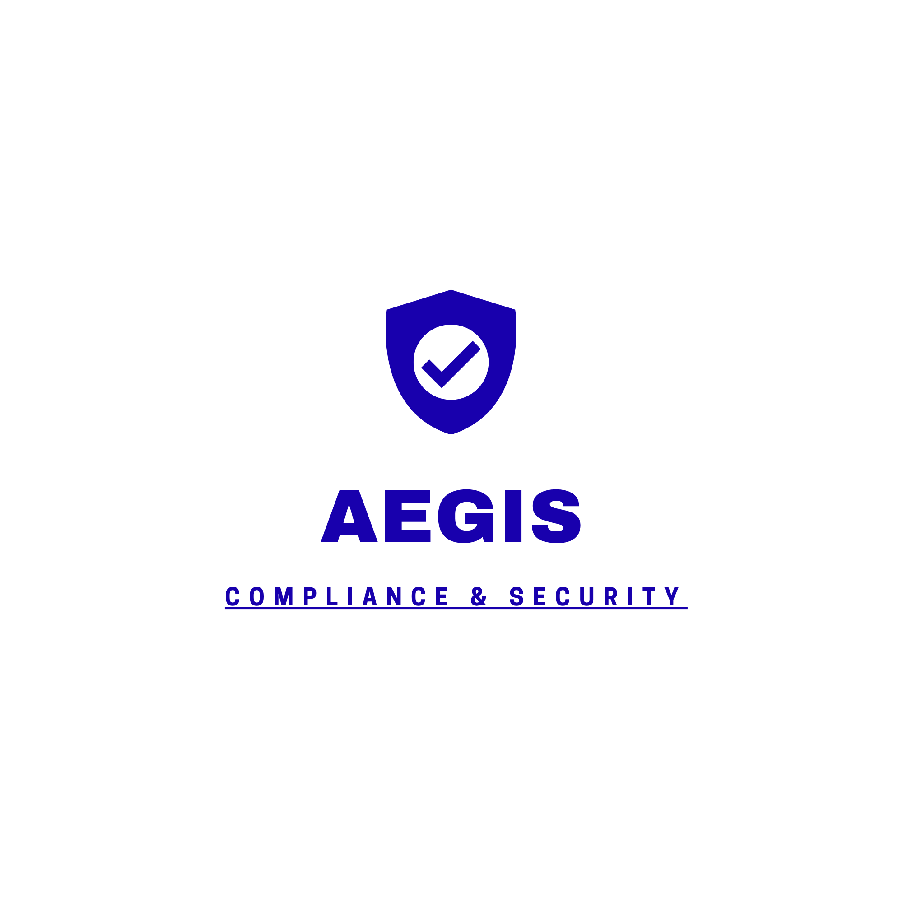

<p align="center">
  
</p>

# Aegis VirtualBox test

This quick setup runs the control plane on one Ubuntu VM and an agent on each
of one Ubuntu VM and one Windows 11 VM. Each VM gets its own mTLS identity.
These scripts and sample credentials are for an isolated test network, not
production.

## One-time VirtualBox setup

1. Give all three VMs bridged networking and reserve a stable IPv4 address for
   the control-plane VM.
2. Create one VirtualBox shared folder named `aegis`, enable Auto-mount, and
   make it available to all three VMs. Install VirtualBox Guest Additions.
   Ubuntu usually mounts it at `/media/sf_aegis`; Windows can access it at
   `\\VBOXSVR\aegis`.
3. Clone this repository on each VM. The Ubuntu control-plane setup installs
   Docker Engine and Compose; the agent setup scripts install/run the agents.
   Install Git first if the VM does not already have it.

On each Ubuntu VM:

```sh
sudo apt-get update
sudo apt-get install -y git
git clone https://github.com/lschwe04/aegis-platform.git
cd aegis-platform
```

On Windows, install Git for Windows if needed, then clone the same repository
and open PowerShell in the cloned folder:

```powershell
git clone https://github.com/lschwe04/aegis-platform.git
Set-Location aegis-platform
```

## Control-plane Ubuntu VM

Find the VM's bridged address with `hostname -I`. From the cloned repository,
run this once (replace the example IP and shared-folder path):

```sh
sudo bash scripts/setup-control-plane.sh 192.168.1.50 /media/sf_aegis
```

The script installs Docker if needed, creates the HTTPS/mTLS certificates,
builds both agents, puts their separate bundles in the shared folder, creates
`.env`, starts Postgres and the control plane, and waits for both to become
healthy. It prints the dashboard password at the end. Keep the CA private key
under `certs/ca` on this VM; it is not copied to the shared folder.
Because this is one shared folder, both agent VMs can access both test client
keys. Use it only on an isolated lab network.

## Ubuntu agent VM

Clone the repository, make sure the control-plane setup above has finished,
then run:

```sh
sudo bash scripts/setup-ubuntu-agent.sh /media/sf_aegis/aegis-vbox
```

The script installs the Ubuntu agent, registers it, and enables a systemd
service that runs after reboot. View its live logs with:

```sh
sudo journalctl -u aegis-agent -f
```

## Windows 11 agent VM

Clone the repository and open PowerShell **as Administrator**. To fetch the
Windows bundle directly from the control-plane VM over SSH (no VirtualBox
shared-folder transfer is needed), enable OpenSSH Server on the Ubuntu VM:

```sh
sudo apt-get update
sudo apt-get install -y openssh-server
sudo systemctl enable --now ssh
```

Then run:

```powershell
.\scripts\setup-windows-agent.ps1
```

The script asks for the control-plane IPv4 address, Ubuntu SSH username, and
bundle directory. It defaults to `vboxuser` and
`/media/sf_aegis/aegis-vbox`, matching the sample setup command below. SSH
prompts for login and sudo authentication as needed. The bundle is transferred
through a temporary archive; the Windows-side temporary copy is removed after
installation, and the temporary archive is removed from Ubuntu.

Alternatively, if the bundle is available in a shared folder, provide its
parent directory explicitly:

```powershell
.\scripts\setup-windows-agent.ps1 -BundlePath "Z:\aegis-vbox"
```

The script installs and registers the agent, imports the test certificates,
and creates a startup task that keeps sending results after reboot. Its log is
`C:\ProgramData\Aegis\agent.log`. The Windows client certificate is also
installed for the current user so the browser can access the dashboard.

## View results and reset

Open `https://192.168.1.50:8000/api/v1/dashboard/ui` from Windows, replace the
example IP, select the Windows client certificate if asked, and sign in as
`admin` using the password printed by the control-plane script (the default
test password is `AegisLab2026!`). The browser must present a client
certificate because the control plane requires mTLS for every HTTPS
connection. The Windows-agent setup imports that certificate only into the
current user's certificate store on the Windows agent VM. If you browse from
the Windows host or another machine, import `windows-agent/ca.crt` from the
host's `aegis-vbox` shared-folder directory into that browser user's Trusted
Root Certification Authorities store, and import
`windows-agent/client.p12` into that user's Personal store. The PFX has an
empty password. It contains a private key; only import it on a trusted
machine in this isolated lab. Both agents should report `[PUSH OK]` in their
logs.

On the control-plane VM:

```sh
docker compose ps
docker compose logs --tail 50 control-plane
```

From the Dashboard, use **Export A4 PDF** on a tenant card for its latest
tenant-wide compliance snapshot, or open **Details ansehen** and export an
individual host report. Both downloads require the authenticated dashboard
session and include tenant branding, findings, framework mapping, and the
agent-reported WORM audit status.

Stop the test and preserve its database with `docker compose down`. To erase
the test database and start over, use `docker compose down -v`.

## Development

Run Go tests from `agent-go` with `go test ./...`; run control-plane tests from
`control-plane` with `pytest`. `docker-compose.prod.yml` and the RMM deployment
scripts are separate deployment examples, not part of this VirtualBox test.
